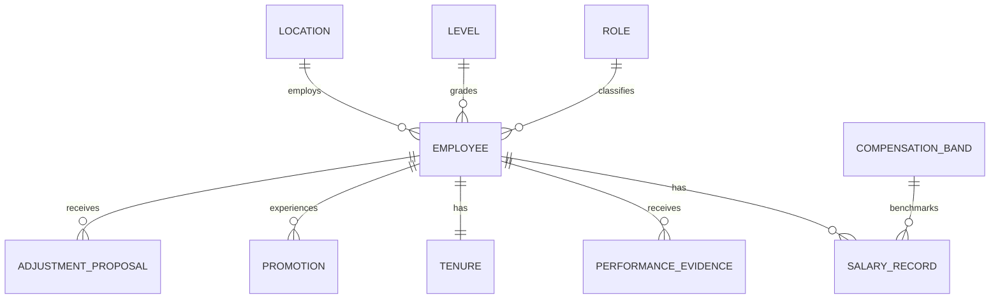

# Database schema and relationship notes

The CSV files are the portable source of truth. `app/database.py` can load them into SQLite for local querying. Primary keys and foreign keys are checked before load.

## Entity relationship overview

A band is uniquely identified by role, level, location and effective period. The generated 2026 bands cover 10 roles x 4 levels x 6 locations = 240 combinations. Production deployments should use a temporal exclusion constraint to prevent overlapping active bands for the same combination.
